# Invoice Intelligence

Invoice Intelligence turns a pile of invoices into checked, searchable data. Upload PDFs,
scans, phone photos, spreadsheets or CSV files, including one PDF holding many invoices. The
system reads them (OCR where needed) and has an LLM extract the key fields. Every value comes
with the exact quote and page it came from. Plain, tested code then parses, calculates and
validates, and anything doubtful is sent to a person to review. Reviewers correct and approve
with a full audit trail, search by words or meaning, cross-check invoices against a ledger
or a second document, and ask an assistant questions whose answers cite their sources and
whose proposed changes wait for a human to confirm. Accuracy is measured on a labelled
synthetic dataset, and the results are reported as they came out.

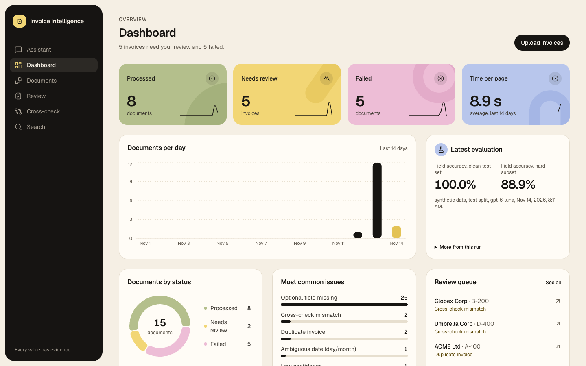

**Contents:** [The assignment](#the-assignment-in-my-own-words) ·
[Quick start](#quick-start) · [Demo data](#demo-data) · [Features](#features) ·
[Screenshots](#screenshots) · [Documentation](#documentation) ·
[Design decisions](#design-decisions-and-trade-offs) ·
[Known limitations](#known-limitations) · [Tests](#tests) · [Evaluation](#evaluation) ·
[AI usage](#ai-usage)

## The assignment, in my own words

Build a working system for a finance team that receives invoices in every shape: clean
PDFs, poor scans, photos taken on a phone, Excel exports, and batches with many invoices in
one file. The system should:

1. accept these files safely;
2. read their text, including from images;
3. extract the important fields reliably, without making anything up;
4. check them and route problems to a person;
5. make everything searchable;
6. handle multi-invoice batches;
7. compare invoices with other records;
8. let people ask questions in plain language.

It must be honest about how well it works, run with one command, and be safe to point at
real financial documents.

## Quick start

Requirements: Docker with Compose v2, `make` and `openssl`; macOS and most Linux systems
already have the last two. Allow about 10 GB of disk for the images. Node 22 is only needed
to run the frontend and end-to-end tests outside Docker.

```bash
git clone https://github.com/hasinabraradib/invoice_intelligence.git
cd invoice_intelligence

# 1. Create your config. It holds only placeholders; it is git-ignored.
cp .env.example .env

# 2. Add any ONE LLM provider key to .env, for example:
#      LLM_PROVIDER=openai
#      OPENAI_API_KEY=sk-...
#    (or LLM_PROVIDER=gemini / groq with LLM_API_KEY=...). Without a key the app still
#    runs, but extraction and the assistant explain that no LLM is configured.

# 3. Build and start everything. This also adds a random API key to .env.
make up

# 4. Open the app
open http://localhost:3000        # or just visit it in your browser
```

`make up` waits until every service is healthy. Check it with
`curl -s http://localhost:3000/api/health`. Stop with `make down`; your data stays in Docker
volumes. Only port 3000 is published, on localhost. Provider details and every setting are
in the [guide](docs/guide.md#llm-providers-bring-your-own-key).

## Demo data

```bash
make demo
```

This generates the synthetic dataset (fixed seed, no real data) and uploads a varied set
through the API:
- text and scanned PDFs, a phone photo, a spreadsheet and a CSV;
- a purchase order, and a duplicate copy of an invoice;
- a six-invoice batch PDF and the ledger it should match.

When processing finishes, it starts a cross-check of the batch against the ledger. Running
it again is safe: files that are already loaded are recognised by their hash.

## Features

Mapped to the seven parts of the assignment, plus the cross-cutting work.

| # | Part of the assignment | What is built |
|---|---|---|
| 1 | **Ingest any invoice safely** | PDF, PNG, JPEG, TIFF, XLSX, XLS and CSV, detected by magic bytes (never by extension or Content-Type). Streaming upload with size and count caps, SHA-256 dedupe, per-file errors in a batch upload, drag-and-drop UI with progress |
| 2 | **Read scans and photos (OCR)** | Tesseract (English and Bengali) with deskew, denoise and binarisation; photo clean-up (lighting flattening, optional perspective warp and contrast); pages in parallel, killable processes; confidence per page |
| 3 | **Extract fields with evidence** | The LLM only copies values and quotes them; every value has status (`found`, `missing`, `uncertain`, `corrected`), evidence, page and confidence. Quotes must be found in the text. Low-confidence or suspicious OCR pages get a vision second opinion that can only confirm or send to review |
| 4 | **Validate and route to review** | Plain-code checks: Decimal money, dates (ambiguous day/month flagged), currencies, line sums, subtotal + tax = total, duplicates by supplier and normalised number. A review queue, side-by-side review with evidence chips, audited corrections, approval with an override reason |
| 5 | **Search** | Keyword (Postgres full text), semantic (local MiniLM embeddings in pgvector) and hybrid search with reciprocal rank fusion; snippets with highlights; results open on the right page |
| 6 | **Batch documents** | One PDF with many invoices is split by page-level rules, with an LLM classifier only for unclear pages. Invoices are extracted in parallel and saved as they finish; partial failures are kept, and retry redoes only the failed invoices. Tested on a 1000-page synthetic batch |
| 7 | **Cross-verification and the assistant** | Invoices vs a ledger spreadsheet or another PDF (purchase order, second copy): matched, mismatched and missing, with evidence on both sides. A chat assistant that answers from tools with citations, does arithmetic in the database, and only *proposes* changes that a person confirms |
| – | Cross-cutting | A background worker with retries, heartbeats and a watchdog; a dashboard; an evaluation harness; security (API keys behind a server-side proxy, rate limits, CSP, hardened containers); a design system with dark mode and phone layouts |

## Screenshots

| Light | Dark |
|---|---|
| 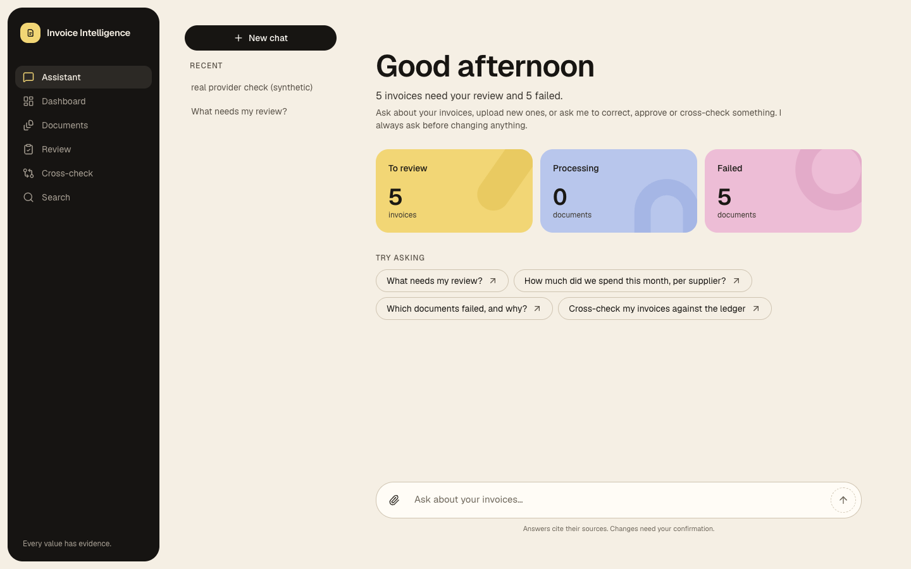 | 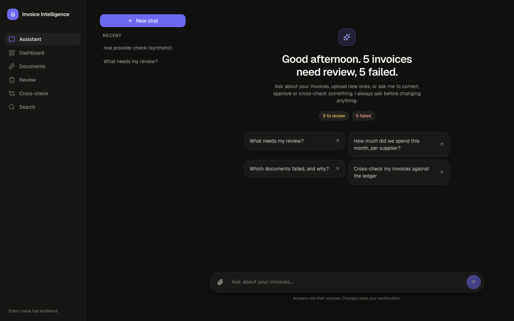 |
| 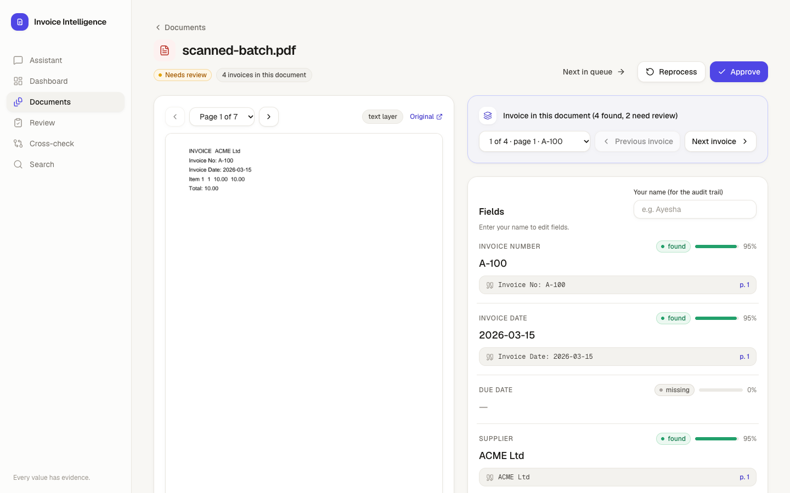 | 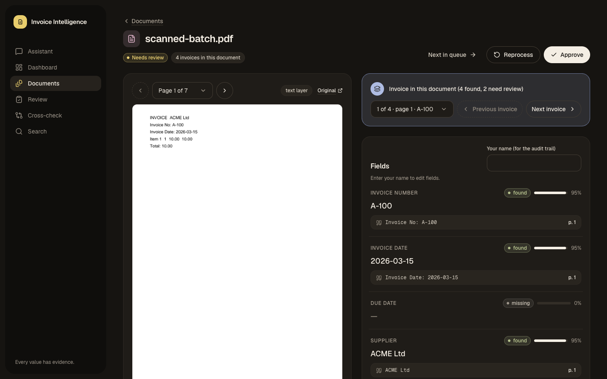 |
| 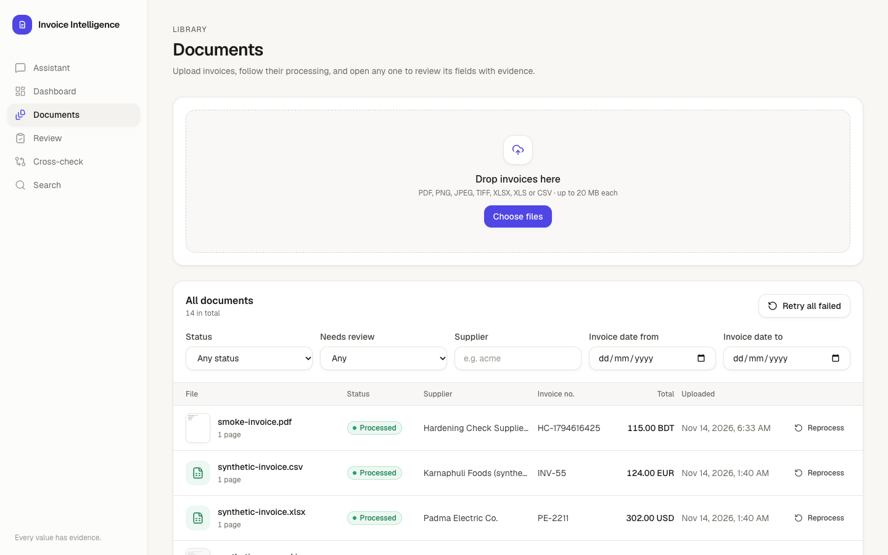 | 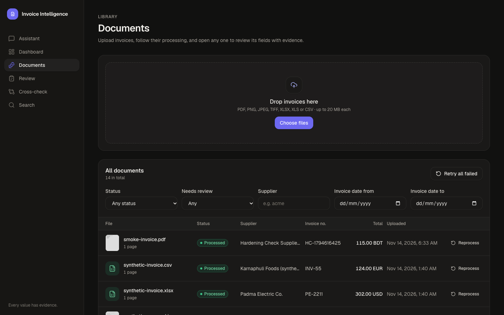 |
| 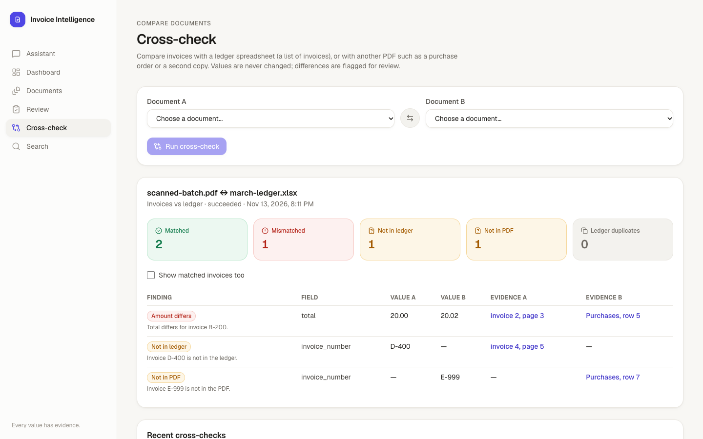 | 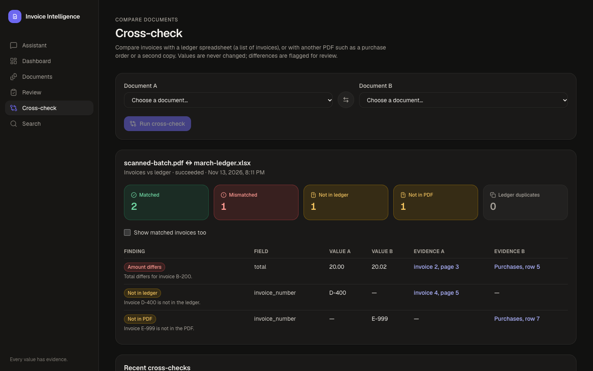 |
| 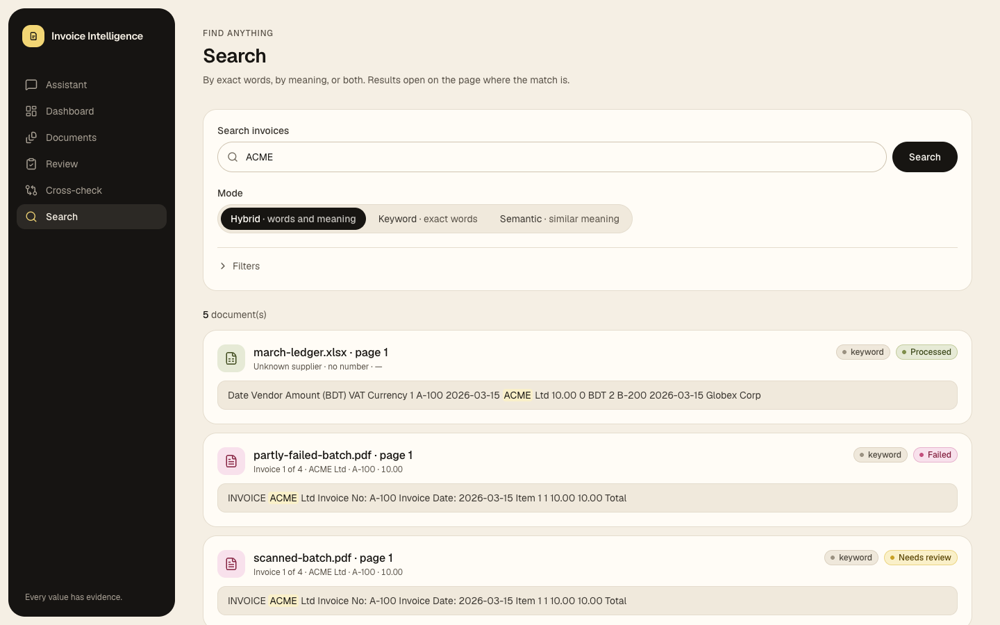 | 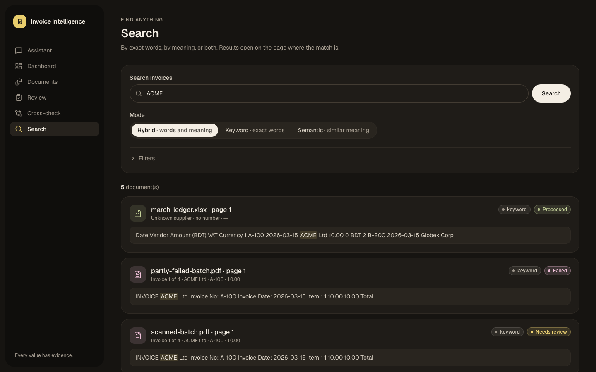 |

Phone layouts, open pickers and the previous design: [docs/screenshots/](docs/screenshots/).

## Documentation

| Document | What is in it |
|---|---|
| [Architecture](docs/architecture.md) | Components, the document flow from upload to review, and the assistant's tool loop, as Mermaid diagrams with rendered images |
| [Database schema](docs/schema.md) | Every table and why it exists |
| [Guide](docs/guide.md) | Feature-by-feature reference: assistant, UI, worker, batches, cross-checks, search, OCR, providers, and the full API |
| [Evaluation](docs/evaluation.md) | Dataset, metrics, results, failure examples and what was learned |
| [Security](docs/security.md) | Threat model and the defence for each threat, linked to code and tests; audit reports |
| [Test results](docs/test-results.md) | Counts, coverage per package and the slowest tests, with the raw JUnit and coverage files |
| [Prompts](docs/prompts.md) | The prompts used to build the project, and the runtime prompts the system sends |
| [AI usage](AI_USAGE.md) | Which AI tools were used, for what, and how their output was reviewed and tested |
| [Project rules](CLAUDE.md) | The rules every change follows |

## Design decisions and trade-offs

- **The LLM only extracts and quotes; code does the rest.** Values must be copied from the
  document with a quote that is then found in the text. Parsing, arithmetic and validation
  are plain, tested code. *Trade-off:* the model cannot "fix" a typo or fill an obvious gap,
  so more invoices go to review. In return, a number never appears that the document doesn't
  contain.
- **Every field may be empty, and says why.** A missing or doubtful value is `missing` or
  `uncertain` with a reason, never a guess. *Trade-off:* less "complete"-looking output.
- **Second opinions, never silent replacements.** The vision reading of a page image can
  raise confidence when it agrees, or send the invoice to review when it disagrees, but it
  never swaps a value in. *Trade-off:* extra cost on scans (about +24% per document on the
  hard set) for catching some confident OCR misreads.
- **One database.** Postgres holds documents, results, full-text search and vectors
  (pgvector), so there is one thing to back up and data stays consistent. *Trade-off:* a
  dedicated search engine would scale further and rank better at very large volumes.
- **Local embeddings.** all-MiniLM-L6-v2 runs on the CPU in the worker, so document text
  isn't sent anywhere just for search. *Trade-off:* smaller-model quality; the similarity
  threshold was calibrated by measurement.
- **Rules first for batches.** Page-level rules split most batches, and the LLM only sees
  short headers of unclear pages. *Trade-off:* unusual layouts may need a reviewer to fix a
  boundary (corrections survive re-splitting).
- **Killable process pools for CPU-heavy steps.** Parsing, OCR and embedding run in separate
  processes with hard timeouts, so one hostile or huge file is killed instead of blocking
  the worker. *Trade-off:* more complexity and process start-up cost.
- **The assistant proposes; people decide.** Writes are proposals with an expiry, applied
  through the same audited code as the UI. *Trade-off:* one extra click per change.
- **A server-side proxy instead of user accounts.** The browser never holds the API key; the
  web server adds it. *Trade-off:* it protects the API, not individual users. Exposing the
  app beyond localhost needs real sign-in in front.
- **Measure on synthetic data, tune only on dev.** The labelled dataset is generated with a
  fixed seed, and held-out test files were never used for tuning. *Trade-off:* the clean
  numbers are an upper bound for real-world documents.

## Known limitations

- **Confident OCR misreads.** On heavily noisy scans Tesseract can read the wrong characters
  with high confidence. Such values pass every check if the totals still add up. The vision
  second opinion now sends most of these invoices to review (6 of 7 erroneous hard-test
  invoices), but not all. Field accuracy on the heavy-noise group is the weak spot (56%).
- **Missing currency is a warning, not a review trigger.** Currency is a *recommended*
  field. When it isn't printed, or is unreadable (for example "BOT" for "BDT"), it is left
  empty with a `MISSING_RECOMMENDED` warning; it is never guessed from the supplier or
  country. Such an invoice can be marked processed without review. Totals are always
  reported per currency, so a missing currency never gets mixed into another currency's
  sum. This was a deliberate choice, because many invoices simply don't print one.
- **A bare "$" is read as USD**, the most common meaning. Other dollar currencies need their
  code printed.
- **OCR languages** are English and Bengali (`OCR_LANGS`); handwriting is not a target.
- **Synthetic evaluation.** The labelled set is generated. Real-world accuracy needs real
  labelled invoices (a template is in `eval/dataset/real/`; `make eval ARGS=--real`).
- **Single API key, no user accounts, localhost by default** (see
  [security.md](docs/security.md)). Rate limits are per network address.
- **Data goes to your LLM provider** when one is configured; their data terms apply.

## Tests

```bash
make test           # backend: unit + integration tests on a throw-away Postgres (Docker)
make lint           # backend: ruff check + format check
make frontend-check # frontend: ESLint, TypeScript, Vitest
make e2e            # browser smoke test against the running stack (upload, review, correct,
                    # approve, search); needs `make up` and Node 22
make test-report    # all of the above with coverage + JUnit -> docs/test-results.md
```

The latest results are in [docs/test-results.md](docs/test-results.md): backend 420 passed
(including slow tests) with 91.5% line coverage, 72 frontend tests, and the end-to-end smoke
test passed.

## Evaluation

Measured end to end through the API and worker with the real provider (OpenAI
`gpt-6-luna`), on 67 labelled **synthetic** invoices: digital and scanned PDFs, photos,
XLSX, CSV, a 9-page batch, a ledger, a purchase order, and "hard" damaged and crowded
documents (12 held out in test, 12 in dev for development). Full tables, failure examples and limitations are in
[docs/evaluation.md](docs/evaluation.md).

| | Clean test (26 invoices) | Hard subset, test (12): before → after photo work |
|---|---|---|
| Field accuracy (9 header fields; correctly empty counts as right) | **100%** | **75.0% → 88.9%** (phone photos 11% → 94%) |
| Invented values / missing values | 0% / 0% | none invented / 13.9% → 7.4% |
| Line items F1 | 100% | 85.9% → 89.4% |
| Validation flags precision / recall | **93.8% / 100%** before the line-sum fix (headline); 100% / 100% after it | invoices with an error flagged for review: 7 of 7 → 6 of 7 |
| Batch segmentation, cross-check findings, duplicate pair | 6/6, 6/6, 1/1 | – |
| Time per document p50 / p95 | 8.5 s / 14 s | 12 s / 37 s |

The assistant answers 15/15 questions with the right number and citation, and cost is
about $0.001 per document at $0.10 / $0.50 per million tokens. The headline flag numbers
are from before a rule bug found on the held-out test split was fixed; the post-fix result
is shown beside them, not instead of them (see docs/evaluation.md for why). The evaluation
also found real bugs that are now fixed: dates from Excel cells were lost, keyword search
failed on natural questions, and embedding a long page hung the worker.

The photo work (see "OCR" in the [guide](docs/guide.md)) was developed only on the hard
**dev** set; the hard test files stayed held out, so the before/after is a fair measurement.
Heavy noise is still the weak spot (56%): the OCR reads it with high confidence but the
wrong characters. To catch such misreads, scans and photos now get a **second reading**
from the page image when something looks off (see [docs/evaluation.md](docs/evaluation.md)). It never replaces a value: a
disagreement sends the invoice to review. On the hard test subset, 6 of 7 invoices with an
error now reach review, no fully correct clean invoice does, and cost goes from about $0.0010
to $0.0013 per document.

The clean numbers are an **upper bound**. The hard subset shows the drop on bad images:
phone photos and heavy noise cause misreads, though every one was flagged for review.
Label real invoices in `eval/dataset/real/` and run `make eval ARGS=--real` for numbers
that mean more.

```bash
make eval-dataset   # regenerate the dataset (fixed seed, byte-identical)
make eval           # isolated stack -> eval/results/<timestamp>.json, docs/evaluation.md, dashboard
```

`make eval` runs in its own compose project (`invoice-eval`) with a fresh database, so your
documents never affect the results and the eval never touches your data. The headline then
appears on the dashboard under "Latest evaluation".

## Security

Every API route except `/health` needs an API key, which only the web server holds. Uploads,
the assistant and search are rate-limited, both servers send strict security headers, and
the app containers run as non-root on read-only file systems. Dependency audits and a
full-history secret scan are recorded. Details and the threat model:
[docs/security.md](docs/security.md).

## AI usage

This project was built with an AI coding assistant (Claude Code), step by step, with every
change tested before it was committed. [AI_USAGE.md](AI_USAGE.md) says which tools were used,
for what, and how their output was reviewed, and [docs/prompts.md](docs/prompts.md) lists
the prompts.
