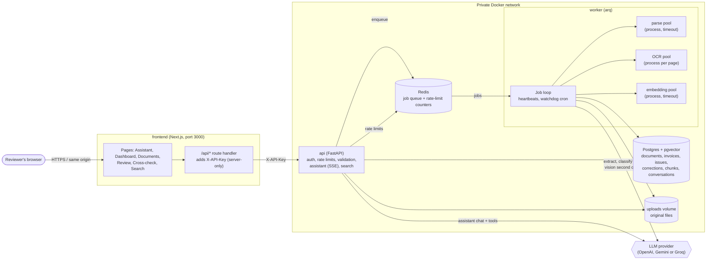
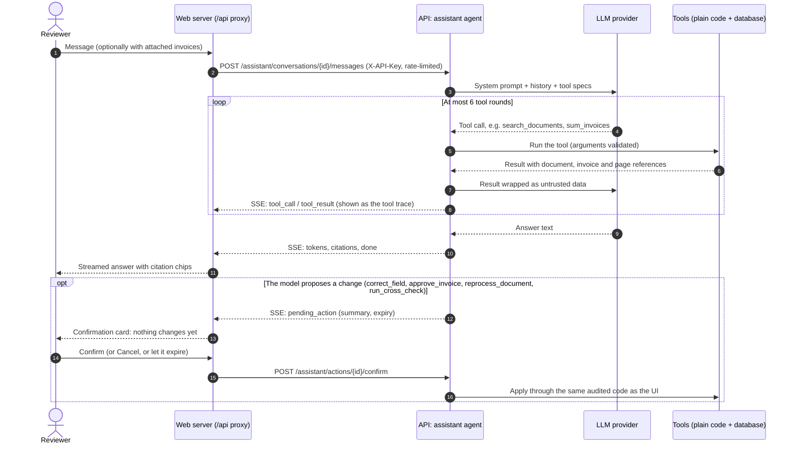

# Architecture

Three views: the running components, the path a document takes from upload to review, and
how the assistant answers with tools. Each diagram is Mermaid (rendered by GitHub), with a
pre-rendered SVG and PNG in [architecture/](architecture/) for viewers that don't render
Mermaid. The database tables are described in [schema.md](schema.md), and the security
boundaries in [security.md](security.md).

## 1. Components

Rendered: [SVG](architecture/components.svg) · [PNG](architecture/components.png)

| Component | Role |
|---|---|
| **frontend** | The UI. The browser only talks to this server. Its `/api/*` route handler forwards allow-listed paths to the API and adds the key, which never reaches the browser. |
| **api** | Uploads (magic-byte type check, size caps, dedupe by hash), results, corrections, approvals, search, cross-checks, the assistant (streamed over SSE), and dashboard statistics. |
| **worker** | Runs the processing pipeline and cross-checks from the Redis queue. CPU-heavy steps run in separate processes with hard timeouts, so a hostile file is killed, not the worker. |
| **Redis** | The job queue (arq) and the per-user rate-limit counters. |
| **Postgres + pgvector** | Everything durable: documents, page texts, invoices, line items, issues, corrections, search chunks with embeddings, conversations, assistant actions and evaluation runs. |
| **LLM provider** | Extraction (quote-backed values), classification of unclear batch pages, the vision second opinion, and the assistant. It never computes or "fixes" values. |

## 2. Document flow: upload to review

Rendered: [SVG](architecture/document-flow.svg) · [PNG](architecture/document-flow.png)

```mermaid
flowchart TD
    up["Upload (browser → proxy → API)"] --> check{"Magic-byte type check,<br/>size and count caps"}
    check -- "not allowed" --> reject["Rejected with a clear error<br/>(the other files still go on)"]
    check -- "ok" --> dedupe{"Same SHA-256<br/>already stored?"}
    dedupe -- "yes" --> existing["Return the existing document"]
    dedupe -- "no" --> store["Store the file (random name) and a<br/>document row; enqueue a job"]
    store --> parse["Parse in a process with a timeout<br/>PDF text layer · images · XLSX/CSV sheets"]
    parse --> needocr{"Pages without<br/>a text layer?"}
    needocr -- "yes" --> photo["Photo preprocessing<br/>(flatten lighting; optional warp, contrast)"]
    photo --> ocr["Tesseract OCR, pages in parallel,<br/>per-page timeout and confidence"]
    needocr -- "no" --> texts
    ocr --> texts["Save page texts<br/>(a retry reuses them)"]
    texts --> seg["Segmentation: rules first,<br/>LLM classifier only for unclear page headers"]
    seg --> each["Each invoice segment, in parallel (bounded)"]
    each --> extract["LLM extraction: values + the quotes they came from"]
    extract --> ground["Grounding: every quote must be in the page text,<br/>else the value is 'uncertain'"]
    ground --> trig{"OCR'd pages with low confidence<br/>or suspicious values?"}
    trig -- "yes" --> vision["Vision second opinion from the page image:<br/>agree → small confidence bonus;<br/>disagree → uncertain, both readings kept, review"]
    trig -- "no" --> validate
    vision --> validate["Plain-code validation: dates, numbers, currencies,<br/>line sums, subtotal + tax = total, duplicates"]
    validate --> save["Upsert the invoice, line items and issues<br/>(idempotent: reprocessing replaces, never duplicates)"]
    save --> embed["Chunk and embed page texts for semantic search<br/>(failure only adds a warning)"]
    embed --> status{"Any errors or<br/>low confidence?"}
    status -- "no" --> processed["Processed"]
    status -- "yes" --> review["Needs review"]
    review --> human["Reviewer: evidence per field, corrections (audited),<br/>approve with an override reason if errors remain"]
    processed --> xc
    human --> xc["Cross-check (on request): invoices vs a ledger sheet<br/>or another PDF → matched / mismatched / missing"]
```

What happens when things go wrong:

- **Permanent errors** (corrupt file, unsupported type, password, a parser that timed out)
  fail the document at once, with the reason shown.
- **Temporary errors** (LLM rate limit or outage, database hiccups) send the job back to the
  queue with backoff, up to `JOB_MAX_ATTEMPTS`.
- **A batch where some invoices fail** becomes *partially failed*. The good invoices are
  kept, and a retry only redoes the failed ones.
- **A stuck job** (no heartbeat) is retried or failed by the watchdog. A worker whose event
  loop blocks exits by itself, and Docker restarts it.

## 3. Assistant: tool-calling flow

Rendered: [SVG](architecture/assistant-flow.svg) · [PNG](architecture/assistant-flow.png)

Tools: `search_documents`, `list_documents`, `get_invoice`, `list_review_queue`,
`get_job_status`, `get_stats`, `get_cross_check`, `sum_invoices` and `count_invoices` read.
`correct_field`, `approve_invoice`, `reprocess_document` and `run_cross_check` only
*propose*. Numbers in answers come from tools such as `sum_invoices` (database arithmetic),
not from the model.
