# Database schema

PostgreSQL 17 with the `pgvector` extension (`pgvector/pgvector:pg17` image). Migrations live
in `backend/alembic/versions/`; the models are in `backend/app/models.py`.

```mermaid
erDiagram
    documents ||--o{ processing_jobs : "is processed by"
    documents ||--o{ invoices : "contains (one per segment)"
    documents ||--o{ page_texts : "has"
    documents ||--o{ text_chunks : "is split into"
    documents ||--o{ ledger_rows : "lists (spreadsheets)"
    documents ||--o{ cross_checks : "is compared in"
    cross_checks ||--o{ cross_check_findings : "finds"
    cross_checks ||--o{ validation_issues : "raises"
    conversations ||--o{ messages : "contains"
    conversations ||--o{ assistant_actions : "proposes"
    invoices ||--o{ line_items : "contains"
    invoices ||--o{ validation_issues : "has"
    invoices ||--o{ corrections : "is corrected by"

    documents {
        uuid id PK
        string filename
        string sha256 UK
        string mime_type
        bigint size_bytes
        int page_count
        text storage_path
        string status "uploaded|processing|processed|needs_review|failed"
        text error
        uuid text_job_id "job that saved the page texts"
        timestamptz created_at
        timestamptz updated_at
    }
    processing_jobs {
        uuid id PK
        uuid document_id FK
        string status "queued|running|succeeded|failed"
        string stage "parsing|ocr|segmenting|extracting|embedding"
        int attempts
        int pages_done
        int pages_total
        int segments_done
        int segments_total
        jsonb segments "invoice boundaries found by this job"
        text error
        timestamptz started_at
        timestamptz finished_at
    }
    invoices {
        uuid id PK
        uuid document_id FK
        int segment_index "UK with document_id"
        int page_start
        int page_end
        uuid job_id "job whose extraction is stored"
        string invoice_number
        string invoice_number_key
        date invoice_date
        date due_date
        text supplier_name
        string supplier_key
        text customer_name
        string currency "ISO 4217"
        numeric subtotal "18,2"
        numeric tax "18,2"
        numeric total "18,2"
        bool needs_review
        string reviewed_by
        timestamptz reviewed_at
        text review_override_reason
        jsonb approved_error_keys
        float overall_confidence
        jsonb fields "status, evidence, page, confidence, reasons"
        jsonb raw_model_output
        timestamptz extracted_at
    }
    line_items {
        uuid id PK
        uuid invoice_id FK
        int position
        text description
        numeric quantity "18,4"
        numeric unit_price "18,4"
        numeric line_total "18,2"
        jsonb fields
    }
    validation_issues {
        uuid id PK
        uuid invoice_id FK
        string code
        string severity "error|warning"
        string field
        text message
        text expected
        text actual
    }
    corrections {
        uuid id PK
        uuid invoice_id FK
        string field
        text old_value
        text new_value
        string corrected_by
        timestamptz corrected_at
    }
    page_texts {
        uuid id PK
        uuid document_id FK
        int page_number
        string source "text_layer|ocr|sheet"
        text text
        float ocr_confidence
        tsvector search "generated, GIN index"
    }
    ledger_rows {
        uuid id PK
        uuid document_id FK
        string sheet_name
        int row_number "as shown in Excel"
        jsonb cells "raw row"
        string invoice_number
        string invoice_number_key
        date invoice_date
        text supplier_name
        string supplier_key
        numeric total "18,2"
        numeric tax "18,2"
        string currency
        jsonb problems
    }
    cross_checks {
        uuid id PK
        uuid document_a_id FK "invoices side"
        uuid document_b_id FK "ledger or invoices"
        string mode
        string status
        jsonb summary
        text error
    }
    cross_check_findings {
        uuid id PK
        uuid cross_check_id FK
        int position
        string kind
        string severity
        string field
        text value_a
        text value_b
        uuid invoice_a_id FK
        uuid invoice_b_id FK
        uuid ledger_row_id FK
        int page_a
        int page_b
        string sheet_b
        int row_b
    }
    conversations {
        uuid id PK
        string title
        timestamptz updated_at
    }
    messages {
        uuid id PK
        uuid conversation_id FK
        int position
        string role "user|assistant|tool"
        text content
        jsonb tool_calls
        string tool_call_id
        string tool_name
        jsonb meta "citations, tools used, actions, attachments"
    }
    assistant_actions {
        uuid id PK
        uuid conversation_id FK
        string tool
        jsonb arguments
        text summary
        string status "pending|confirmed|cancelled|expired|failed"
        jsonb result
        timestamptz expires_at
    }
    text_chunks {
        uuid id PK
        uuid document_id FK
        int page_number
        int chunk_index
        text text
        vector embedding "384, HNSW cosine index"
    }
```

## Why each table exists

| Table | Why |
|---|---|
| `documents` | One row per uploaded file. The unique `sha256` means the same bytes are stored only once. `status` is what the UI shows. |
| `processing_jobs` | One row per processing run, so you can see how many attempts there were and which `stage` failed, without overwriting history. It also holds progress (pages and invoices done) and the segmentation it found, so a retry of the same job resumes with the same boundaries. |
| `invoices` | One row per invoice found in a document (`segment_index`, `page_start`-`page_end`); a scanned batch PDF can hold hundreds. Re-processing updates the rows whose page range is unchanged, so `corrections` stay attached. `job_id` records which job's extraction is stored, so a retry skips finished invoices. Money is `NUMERIC`, never float. |
| `line_items` | Invoice rows in printed order (`position`). They're replaced on every run, which keeps re-processing idempotent. |
| `validation_issues` | What the rules flagged (errors and warnings) and why: the review queue reads this. Issues with a `cross_check_id` came from a cross-check; they survive re-validation and are replaced only when that check runs again. |
| `corrections` | Audit trail of human edits (who changed what, from what, and when). Never deleted on re-processing. |
| `page_texts` | Text of every page or sheet, for keyword search (generated `tsvector` with a GIN index). |
| `ledger_rows` | Every row of a spreadsheet, with its sheet and Excel row number as evidence. For ledger sheets (lists of invoices) the mapped fields are filled; `cells` keeps the raw row so a corrected mapping can be applied without re-parsing. The mapping itself is `documents.ledger_mapping`. |
| `cross_checks` | One comparison of two documents (invoices vs a ledger, or invoices vs invoices). One row per pair: running it again replaces its results. |
| `cross_check_findings` | Each match or difference, with value A and value B and the evidence on both sides (invoice and page; ledger sheet and row). |
| `conversations` | One chat with the assistant. |
| `messages` | Every step of a chat: the user's message, the model's tool calls, the tool results and the answer (with citations), so each answer can be traced to its data. |
| `assistant_actions` | Changes the assistant proposed. They run only when the user confirms, and expire after 10 minutes. |
| `text_chunks` | Pieces of about 500 tokens from one page each (50-token overlap) with their 384-number embedding, for semantic search. An HNSW index makes nearest-neighbour lookups fast. They're replaced on every run (idempotent), and chunks never cross pages, so every hit has a page number. |

Unique: `invoices(document_id, segment_index)`. Indexes: `invoices(document_id)`, `invoices(supplier_key, invoice_number_key)` and `invoices(supplier_key, invoice_date, total)`
for the duplicate checks, and `documents(status)` for listing by status. Foreign keys cascade
on delete, so deleting a document removes everything derived from it.
