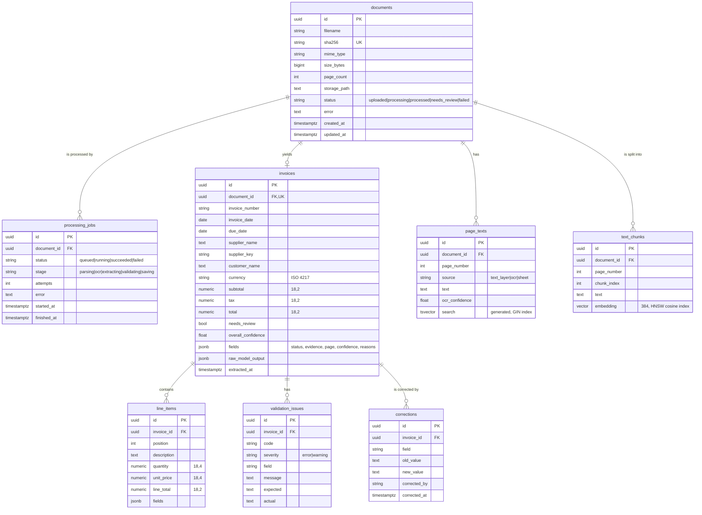

# Database schema

PostgreSQL 17 with the `pgvector` extension (`pgvector/pgvector:pg17` image). Migrations live
in `backend/alembic/versions/`; the models are in `backend/app/models.py`.

## Why each table exists

| Table | Why |
|---|---|
| `documents` | One row per uploaded file. The unique `sha256` means the same bytes are stored only once. `status` is what the UI shows. |
| `processing_jobs` | One row per processing run, so you can see how many attempts there were and which `stage` failed, without overwriting history. |
| `invoices` | The extracted invoice, at most one per document. Re-processing updates the same row, so `corrections` stay attached. Money is `NUMERIC`, never float. |
| `line_items` | Invoice rows in printed order (`position`). They're replaced on every run, which keeps re-processing idempotent. |
| `validation_issues` | What the rules flagged (errors and warnings) and why: the review queue reads this. |
| `corrections` | Audit trail of human edits (who changed what, from what, and when). Never deleted on re-processing. |
| `page_texts` | Text of every page or sheet, for keyword search (generated `tsvector` with a GIN index). |
| `text_chunks` | Pieces of about 500 tokens from one page each (50-token overlap) with their 384-number embedding, for semantic search. An HNSW index makes nearest-neighbour lookups fast. They're replaced on every run (idempotent), and chunks never cross pages, so every hit has a page number. |

Indexes: `invoices(supplier_key, invoice_number_key)` and `invoices(supplier_key, invoice_date, total)`
for the duplicate checks, and `documents(status)` for listing by status. Foreign keys cascade
on delete, so deleting a document removes everything derived from it.
